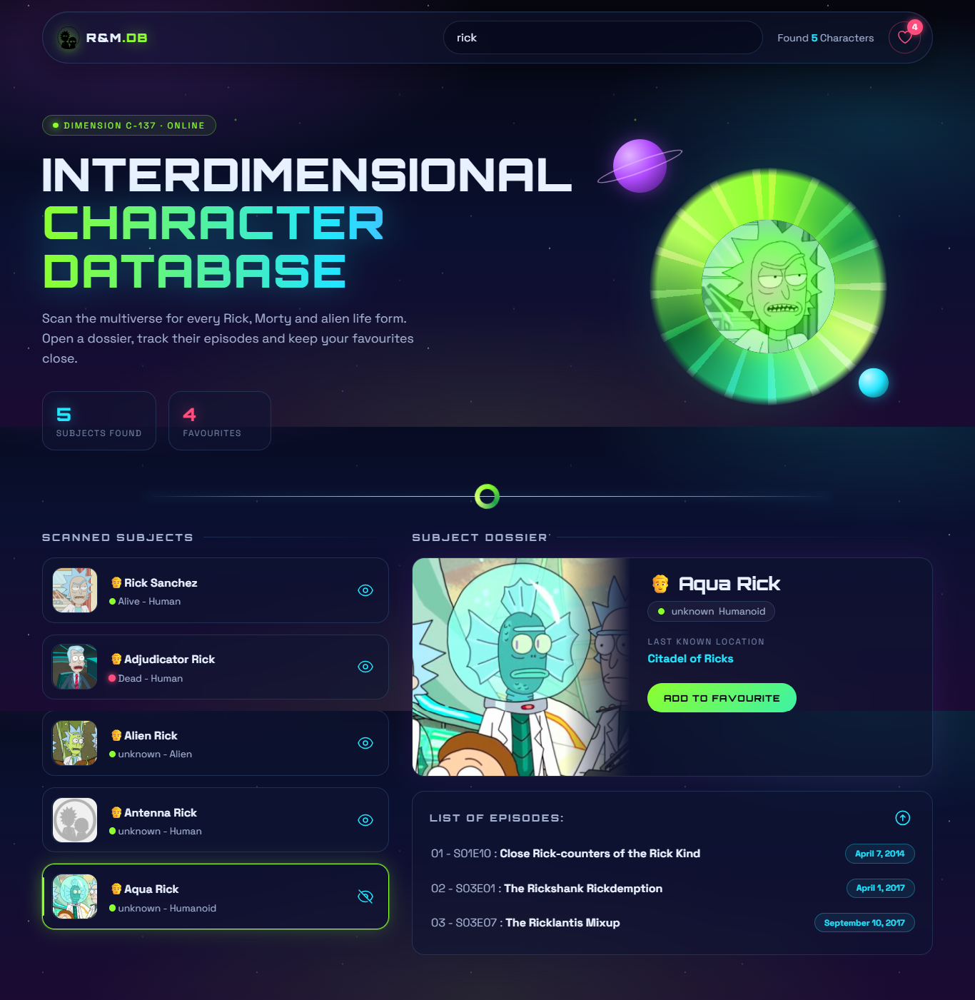

# Rick and Morty – Character Database

A small React app for exploring characters from *Rick and Morty* using the public [Rick and Morty API](https://rickandmortyapi.com/). Search the multiverse by name, open a character's dossier with the episodes they appear in, and keep a list of favourites.



## Features

- **Live search** by character name, with request cancellation (`AbortController`) so only the latest search is shown
- **Character dossier**: status, species, gender, last known location and the full list of episodes they appear in
- **Favourites** saved in `localStorage` and managed from a modal in the navbar
- Loading skeletons and toast error messages
- Animated portal hero with a pointer parallax effect, glass-style UI, responsive layout

## What it practises

Custom hooks (`useCharacters`, `useLocalStorage`), `useEffect` with cleanup, component composition (compound navbar), lifting state up, and data fetching with Axios.

## Tech stack

React 18, Vite, Axios, React Hot Toast, Heroicons, ESLint.

## Getting started

```bash
git clone https://github.com/parisa-adli/Rick-and-Morty.git
cd Rick-and-Morty
npm install
npm run dev
```

Then open http://localhost:5173.

| Script | What it does |
|--------|--------------|
| `npm run dev` | Start the Vite dev server |
| `npm run build` | Production build |
| `npm run preview` | Preview the production build |
| `npm run lint` | ESLint |

## Project structure

```
src/
  components/   # Navbar, CharacterList, CharacterDetail, Modal, Loader
  hooks/        # useCharacters, useLocalStorage
  App.jsx
```

## Credits

Data from [rickandmortyapi.com](https://rickandmortyapi.com/). Rick and Morty is a trademark of its respective owners; this is a non-commercial learning project.

## License

MIT
